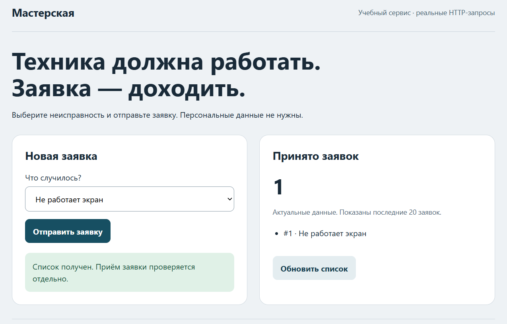

# [compose.student.yaml](../compose.student.yaml)

```
 ✔ Container docker-api-1 Healthy                                                                                   7.3s
 ✔ Container docker-web-1 Started                                                                                   7.1s

root@Kreiser-PC:/mnt/c/Users/Kreiser/Desktop/Docker# docker ps
CONTAINER ID   IMAGE               COMMAND           CREATED          STATUS                    PORTS                      NAMES
13ea21c26efb   devops-student:v1   "python app.py"   37 seconds ago   Up 29 seconds (healthy)   127.0.0.1:8080->8000/tcp   docker-web-1
f9839b1ae1f6   devops-student:v1   "python app.py"   38 seconds ago   Up 34 seconds (healthy)   8000/tcp                   docker-api-1

root@Kreiser-PC:/mnt/c/Users/Kreiser/Desktop/Docker# docker compose -f compose.student.yaml up -d --no-deps --force-recreate api
[+] up 1/1
 ✔ Container docker-api-1 Started                                                                                  13.7s
```


