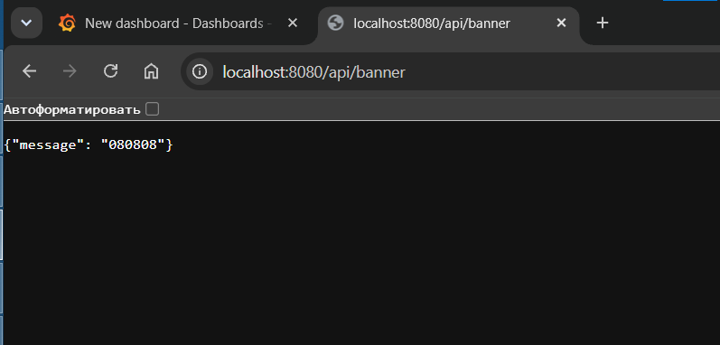

```
root@Kreiser-PC:/mnt/c/Users/Kreiser/Desktop/Docker# docker compose run --rm ansible demo.yml
Container docker-ansible-run-9c34daa6cdd6 Creating
Container docker-ansible-run-9c34daa6cdd6 Created

PLAY [Demonstrate declarative file management inside the lab volume] ***************************************************

TASK [Write a demonstration note] **************************************************************************************
ok: [localhost]

PLAY RECAP *************************************************************************************************************
localhost                  : ok=1    changed=0    unreachable=0    failed=0    skipped=0    rescued=0    ignored=0

root@Kreiser-PC:/mnt/c/Users/Kreiser/Desktop/Docker# docker compose run --rm ansible demo.yml
Container docker-ansible-run-145eec1fc97d Creating
Container docker-ansible-run-145eec1fc97d Created

PLAY [Demonstrate declarative file management inside the lab volume] ***************************************************

TASK [Write a demonstration note] **************************************************************************************
ok: [localhost]

PLAY RECAP *************************************************************************************************************
localhost                  : ok=1    changed=0    unreachable=0    failed=0    skipped=0    rescued=0    ignored=0
```


