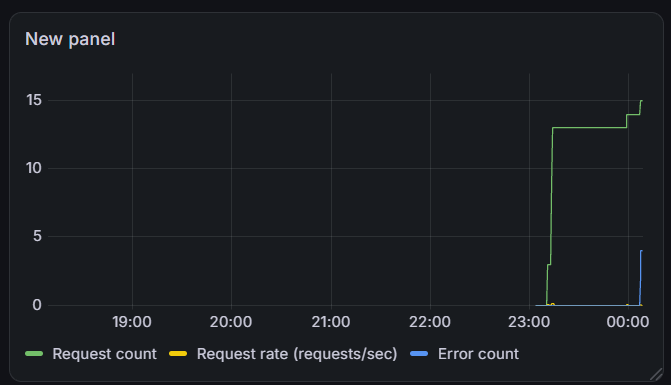

Я добавил счётчик 503.



Заметив ошибки, я проверяю `docker compose ps`.

```
root@Kreiser-PC:/mnt/c/Users/Kreiser/Desktop/Docker# docker compose ps
NAME                  IMAGE                     COMMAND                  SERVICE      CREATED             STATUS                       PORTS
docker-grafana-1      grafana/grafana:13.2.3    "/run.sh"                grafana      About an hour ago   Up About an hour             127.0.0.1:3000->3000/tcp
docker-prometheus-1   prom/prometheus:v3.13.4   "/bin/prometheus --c…"   prometheus   About an hour ago   Up About an hour             127.0.0.1:9090->9090/tcp
docker-web-1          devops-student:v1         "python app.py"          web          About an hour ago   Up About an hour (healthy)   127.0.0.1:8080->8000/tcp
```

Заметив, что API не работает, поднимаю всё снова:

```
root@Kreiser-PC:/mnt/c/Users/Kreiser/Desktop/Docker# docker compose -f compose.student.yaml up -d
[+] up 2/2
 ✔ Container docker-web-1 Running                                                                                   0.0s
 ✔ Container docker-api-1 Healthy                                                                                   4.4s
```

Теперь всё работает.
